# Proposed System Architecture

Every diagram is a **proposed design**, not a deployed or validated system. Dataset scale (~99k orders, ~1M geography rows) does not justify a distributed platform. The main challenge is temporal correctness, not throughput. See [audit](01_DATASET_AUDIT.md), [replay](05_REPLAY_AND_DATA_DESIGN.md) and [contracts](07_API_AND_EVENT_CONTRACTS.md).

## Architecture Decision

Recommend a modular backend with PostgreSQL, FastAPI, Streamlit, one scoring/batch worker, and a **separate replay scheduler**. Separating the scheduler is necessary because it reads future truth; scoring must not share its raw-data access. Delivery/CX inference and rules are distinct modules in the worker, not separate services. Forecasting is a scheduled job. PostgreSQL event/jobs tables replace Redis in MVP. Offline fitting is a separately authorized lifecycle, never part of request serving.

scikit-learn pipelines are sufficient for baselines and initial candidates; XGBoost is optional after evidence of benefit. Versioned artifact directories plus a manifest suffice initially; MLflow is an optional experiment UI. Streamlit avoids React build/auth complexity; React is justified only for richer controls or team expertise. Compose is future local packaging, not evidence of production readiness. GitHub Actions is a future code/contract-check runner, not automatic model promotion or cloud deployment.

## 1. System Context — C4 Level 1

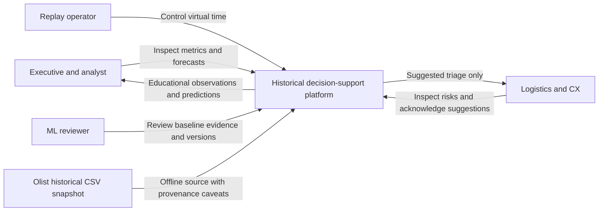

No external business system or customer messaging integration exists. Publisher provenance and local dataset version remain unverified; the local hashes identify the analyzed bytes.

## 2. Containers and Service Boundaries — C4 Level 2, MVP

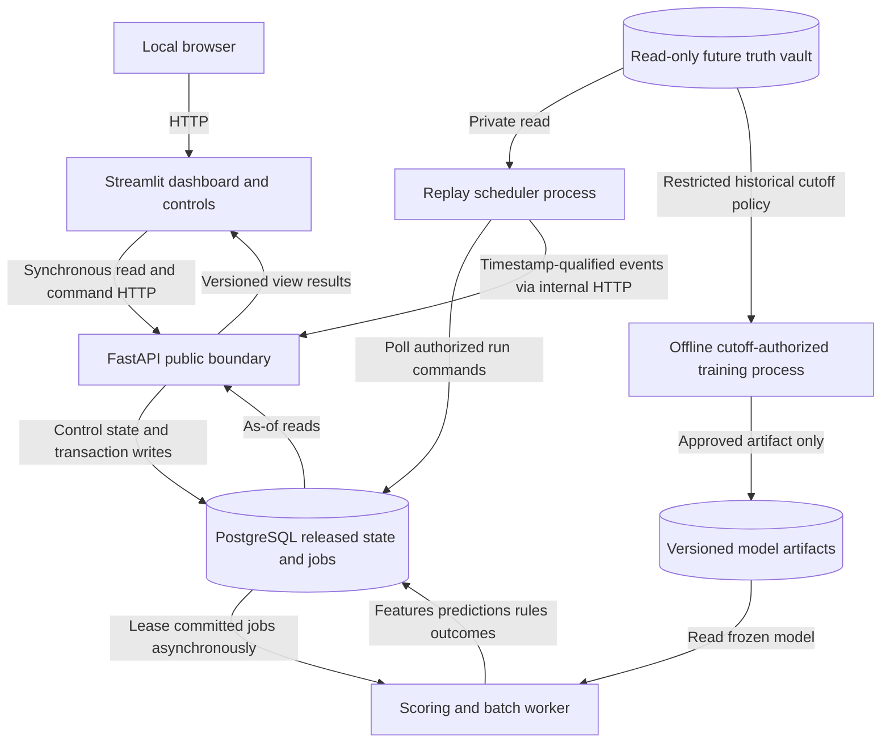

The API owns ingestion/state and read interfaces; worker owns ML/policy outputs. Shared PostgreSQL is acceptable for a modular MVP, with logical schema/role ownership. Scheduler's DB permission is limited to control/checkpoint metadata; event application must pass ingestion. Raw vault is mounted only to scheduler and separately authorized offline training, never API/UI/worker. One process per risk model adds no demonstrated value.

## 3. Backend Components — C4 Level 3

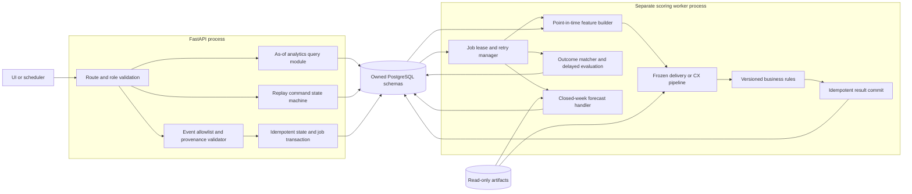

In-process calls inside API/worker are synchronous functions. API ingestion and worker execution are asynchronous across committed jobs. M2 eligibility is resolved before features; all events at a timestamp are visible while cross-order feature history remains strictly earlier. Label matching never changes the saved input snapshot or probability.

## 4a. Source Relational ERD — Observed Conceptual Cardinalities

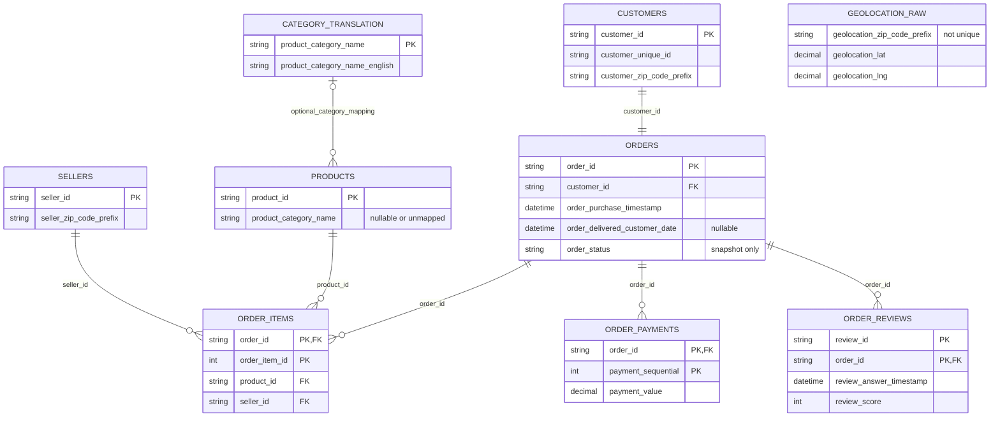

Customer/order is exactly 1:1 in this local snapshot; real-person repeats use customer_unique_id, not that FK. Review PK is composite. Raw geography is deliberately unconnected: a direct join fans out. Translation has 610 null product categories and 13 nonnull unmatched products. All raw declarations describe observed candidate keys, not existing physical constraints.

## 4b. Proposed Curated and Operational ERD

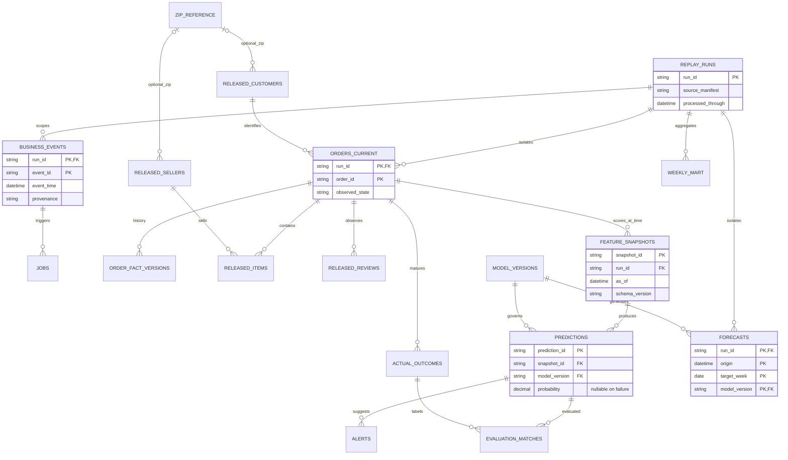

This is a logical design, not migration DDL. Diagram keys abbreviate details: all order-scoped joins must include run_id; artifact versions are global immutable references. Weekly marts derive from event-qualified order facts; forecast actual matching uses target week and run, not a direct per-order FK. Source-to-curated lineage retains all nine raw tables even when payments and geography remain offline reference/reconciliation inputs.

## 5. Data Flow and Future-Truth Isolation

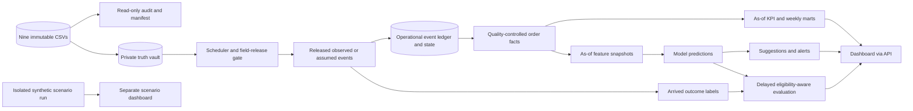

Layers are logical, not separate database products. “Bronze” truth must not be an application-readable schema. Synthetic experiments have a separate run and never feed genuine evaluation.

## 6. Event-to-Decision Sequence and Delayed Labels

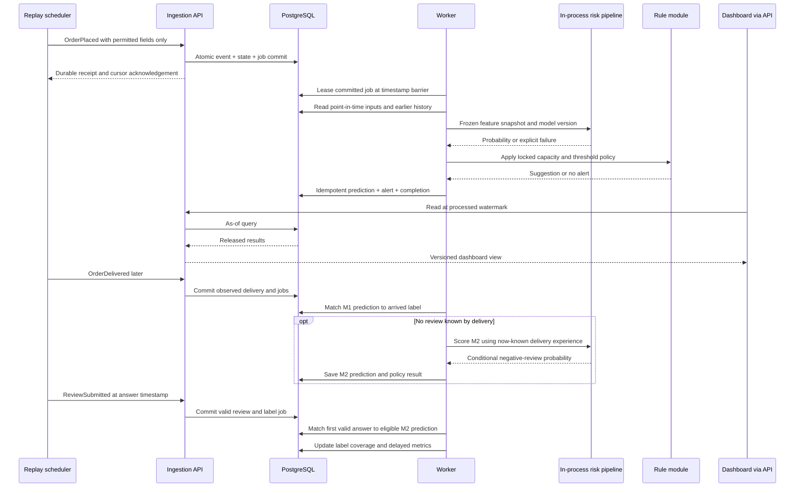

Scoring is asynchronous; durable ingestion does not imply completed prediction. No-review cases never acquire a fabricated negative label.

## 7. Offline Training, Registry and Separate Forecast Batch

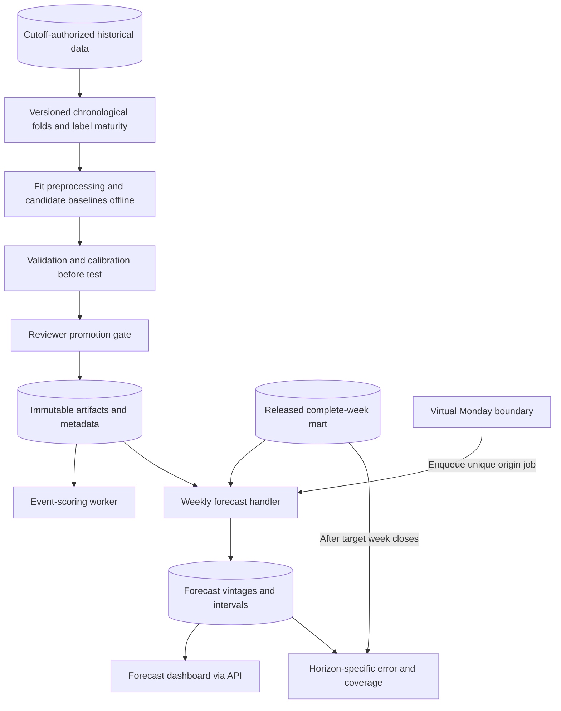

No automatic fitting on holdout data. Weekly lag refresh is inference; retraining is a separate protocol. MLflow, if added, records runs/artifacts; it does not establish temporal validity by itself.

## 8. Proposed Local Deployment

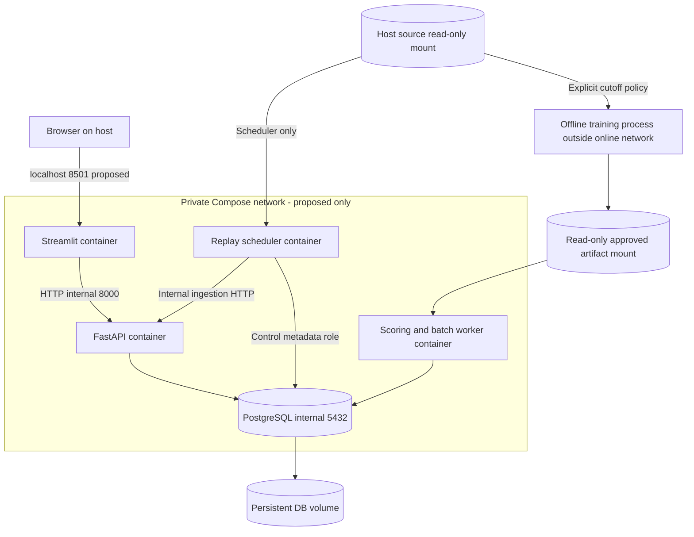

Ports are proposals, not listeners created here. Bind UI to loopback; API and DB need no host exposure. Scheduler and worker are separate even if they share a code image. No Redis container in MVP. Suggested planning allowance: 8 GB RAM minimum target, 16 GB comfortable, several GB disk for DB/indexes and artifacts; **not measured**. Source files total roughly 126 MB. Avoid loading million-row geography in each process; precompute a versioned reference only in a later authorized preparation stage. Measure actual memory before committing limits. No GPU requirement is justified.

## 9. Replay State and Checkpoint Diagram

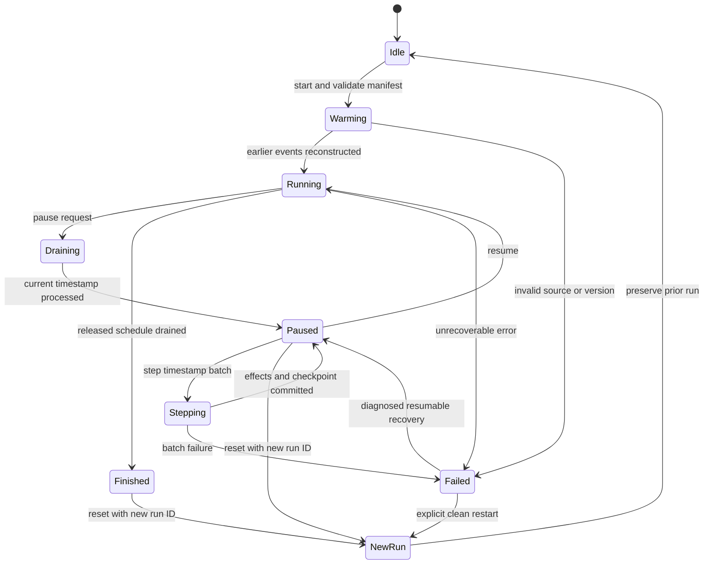

Speed changes are self-transitions within Running or Paused; they do not alter event order. Commit-before-cursor and per-consumer idempotency permit retries. Finished means all available scheduled observations consumed, not all orders delivered or reviewed.

## 10. Optional Expanded Services

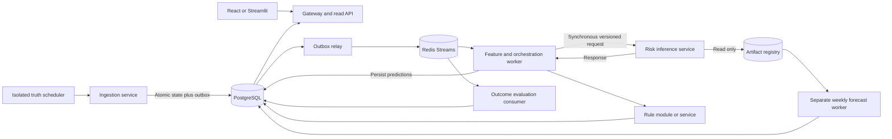

Only adopt after a measured need for independent release/scaling or team ownership. Inference owns no operational DB writes; orchestration persists outputs. A rule service is optional, not mandatory. Shared DB may remain initially with schema ownership; separate databases multiply consistency and deployment work without present evidence. Redis adds relay/consumer recovery, not better data fidelity.

## Reliability, Security and Verification

Database transactions eliminate the MVP dual-write gap. Worker leases expire safely after crashes; unique keys prevent repeated predictions/alerts. Source/schema errors enter quarantine with counts; missing model artifacts make risk unavailable while analytics continues. Metrics distinguish virtual event lag, wall processing latency and label delay. Log run/event/model/correlation IDs, not review text or raw identifiers in public logs.

Restrict raw mounts, DB roles and model promotion. Use parameterized queries, bounded filters/pagination, localhost bindings and secrets outside source control in any future implementation. Backup manifests, artifacts and DB together; resetting replay is not a backup. Test future-data denial, same-time barriers, duplicate delivery, crash recovery, run isolation, metric reconciliation and delayed labels before a demo. Details: [test strategy](09_ML_OPS_AND_TEST_STRATEGY.md).

## Assumptions / Evidence / Open Questions

Evidence: local data is modest and relational; time anomalies are real. Assumptions: one laptop, a small capstone team and no external integration. Open questions: actual machine budget and team expertise. Diagrams have been authored and structurally inspected as Mermaid source; rendered layout and runtime behavior are not validated in this planning-only phase.
